<div align="center">

# 🎵 SonoraMusic

**Pemutar musik Android modern dengan tampilan *glassmorphism*, lirik tersinkron, dan statistik dengar bulanan.**


<br>

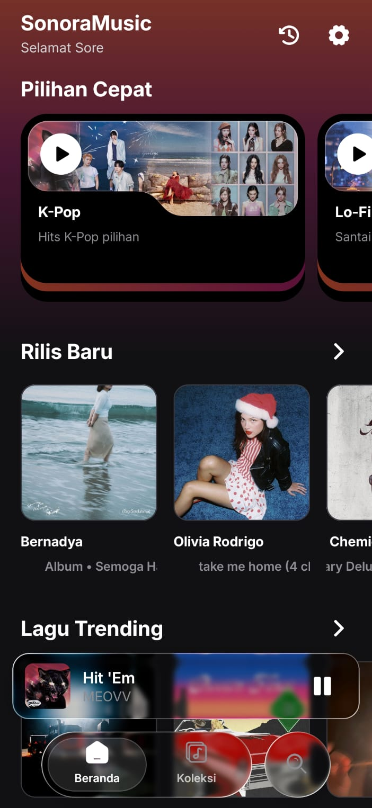
&nbsp;
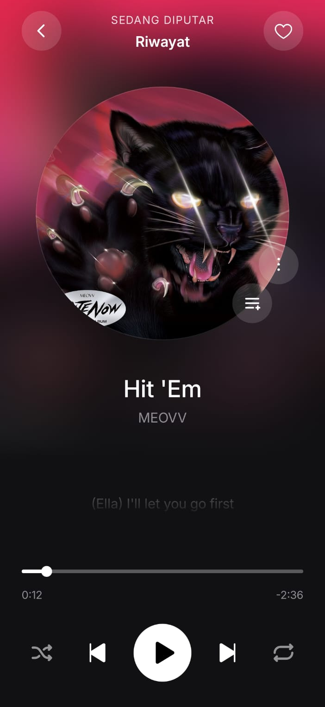
&nbsp;
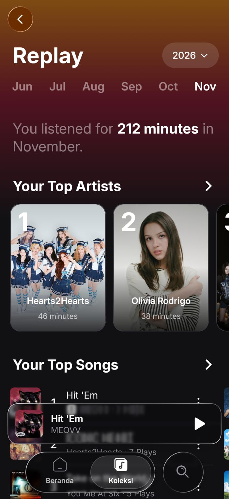

</div>

---

## ✨ Fitur Unggulan

| | Fitur | Ringkasan |
|---|---|---|
| 🏠 | [Beranda dinamis](#-beranda-dinamis) | Pilihan Cepat, Rilis Baru, dan Lagu Trending |
| 🎧 | [Pemutar penuh](#-halaman-sedang-diputar) | Geser cover untuk ganti lagu, ketuk artis untuk buka profilnya, warna latar mengikuti sampul |
| 📝 | [Lirik tersinkron](#-lirik-tersinkron) | Lirik berjalan mengikuti lagu secara real-time |
| 🖼️ | [Kartu lirik](#️-bagikan-kartu-lirik) | Bagikan potongan lirik sebagai gambar yang cantik |
| 📚 | [Koleksi](#-koleksi) | Favorit, Replay, Paling Sering Diputar, Diunduh, dan Riwayat |
| 📊 | [Replay bulanan](#-replay-statistik-dengarmu) | Rekap menit mendengar, artis, dan lagu teratas |
| 🎼 | [Playlist & Import](#-playlist-dan-import) | Buat playlist sendiri atau impor dari link Spotify / YouTube |
| 🎤 | [Halaman artis](#-halaman-artis) | Profil artis, deskripsi, dan lagu populer |
| 🔍 | [Pencarian](#-pencarian) | Cari lagu atau artis lalu putar langsung |
| ⚙️ | [Pengaturan lengkap](#️-pengaturan-lengkap) | Crossfade, kualitas audio, timer tidur, unduhan, dll. |

---

## 🏠 Beranda Dinamis


Halaman utama menyambut kamu sesuai waktu (*Selamat Pagi / Siang / Sore / Malam*) dan menampilkan:

- **Pilihan Cepat** – kartu genre besar (K-Pop, Lo-Fi, Pop Punk, Pop, Jazz, dan **Mix**) dengan tombol *play* langsung. Isinya **diperbarui tiap minggu** dan disimpan di perangkat, jadi tetap terasa segar.
- **Rilis Baru** – album dan single terbaru dalam daftar geser horizontal.
- **Lagu Trending** – chart lagu yang sedang naik daun.
- **Jelajahi genre** – Pop, K-Pop, R&B & Soul, Dance & Elektronik, Hip-Hop, Indonesia Pop, J-Pop, Jazz, Klasik, dan lainnya.
- Akses cepat ke **Riwayat** dan **Pengaturan** dari pojok kanan atas.
- **Mini player** melayang dan **bottom bar kaca** yang menyatu dengan konten di belakangnya.

<br clear="right">

---

## 🎧 Halaman Sedang Diputar


Pemutar layar penuh yang dirancang agar enak dipandang:

- **Cover melingkar** dengan **warna latar otomatis** diambil dari warna dominan sampul album.
- Kontrol lengkap: **putar/jeda, sebelumnya, berikutnya, acak (shuffle), dan ulangi (repeat)**.
- **Geser cover** untuk pindah lagu: geser ke **kiri ➜ lagu berikutnya**, geser ke **kanan ➜ lagu sebelumnya**. Cover lagu tujuan ikut terlihat saat digeser.
- **Ketuk nama artis** untuk membuka **halaman artis**. Jika lagu punya beberapa artis (mis. *Olivia Rodrigo & Chappell Roan*), muncul pilihan artis yang ingin dibuka.
- **Tarik layar ke bawah** untuk menutup pemutar dan kembali ke halaman sebelumnya.
- **Seekbar** dengan penanda durasi berjalan dan sisa waktu.
- Tombol **favorit ❤️**, **tambah ke antrean**, dan **menu titik tiga** (tambahkan ke playlist, putar selanjutnya, unduh, bagikan).
- Pratinjau **baris lirik aktif** langsung di bawah judul lagu.
- Berjalan sebagai **foreground service** (Media3 MediaSession) sehingga musik tetap main saat aplikasi ditutup, lengkap dengan **notifikasi pemutar**.

<br clear="left">

---

## 📝 Lirik Tersinkron

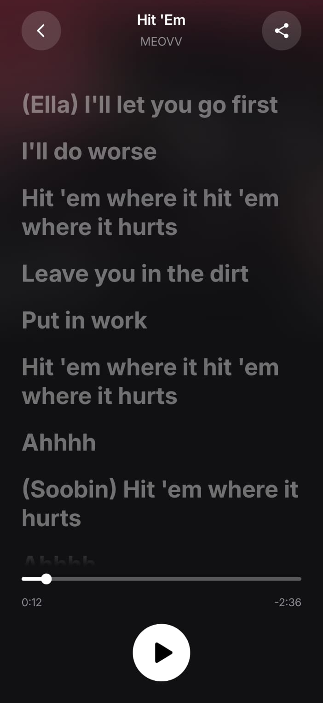

Ketuk area lirik untuk membuka tampilan lirik penuh:

- Lirik **berformat LRC** (disinkronkan per baris) diambil dari [LRCLIB](https://lrclib.net) – gratis dan tanpa API key.
- Baris yang sedang dinyanyikan **disorot otomatis** dan layar ikut bergulir.
- **Validasi cerdas**: lirik hanya dipakai bila durasinya cocok dengan lagu (toleransi ±8 detik) dan memiliki cukup baris. Lebih baik tanpa lirik daripada lirik yang salah waktu.
- Hasil lirik di-*cache* sehingga pembukaan berikutnya instan.
- Tombol **bagikan** di pojok kanan atas untuk membuat kartu lirik.

<br clear="right">

---

## 🖼️ Bagikan Kartu Lirik

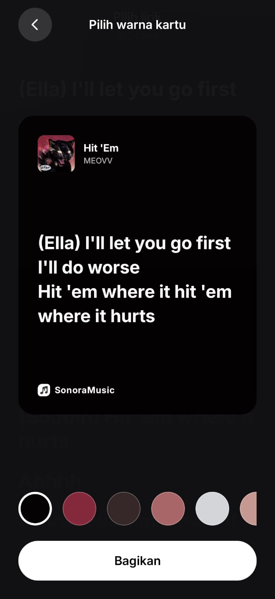

Ubah potongan lirik favoritmu menjadi **gambar siap bagikan** ala story media sosial:

1. Pilih hingga **3 baris** lirik favoritmu.
2. Pilih **warna kartu** dari palet yang tersedia.
3. Ketuk **Bagikan** dan kirim ke aplikasi apa pun.

Kartu memuat sampul, judul, nama artis, lirik terpilih, dan branding **SonoraMusic**.

<br clear="left">

---

## 📚 Koleksi

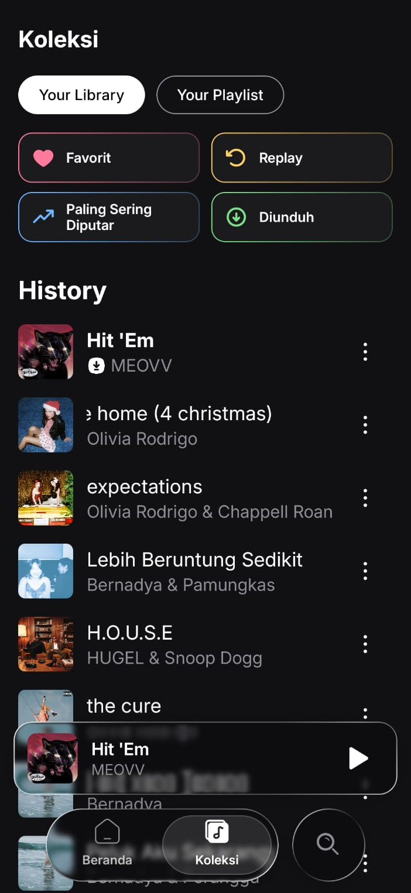

Semua musikmu di satu tempat, dengan dua tab: **Your Library** dan **Your Playlist**.

- ❤️ **Favorit** – lagu yang kamu sukai.
- 🔁 **Replay** – rekap kebiasaan dengarmu ([lihat di bawah](#-replay-statistik-dengarmu)).
- 📈 **Paling Sering Diputar** – lagu yang paling sering kamu putar.
- ⬇️ **Diunduh** – lagu yang bisa diputar **tanpa internet**, ditandai ikon unduhan di samping nama artis.
- 🕘 **History** – riwayat putar terbaru, lengkap dengan menu aksi per lagu.

<br clear="right">

---

## 📊 Replay: Statistik Dengarmu


Rekap musik pribadi, mirip *Wrapped* tetapi **tersedia setiap bulan**:

- Pilih **tahun** dan **bulan** lewat selektor di bagian atas.
- Total **menit mendengarkan** dalam sebulan.
- **Your Top Artists** – peringkat artis lengkap dengan foto dan durasi dengar.
- **Your Top Songs** – peringkat lagu lengkap dengan jumlah putaran.
- Semua data dihitung dan disimpan **lokal di perangkat**, tanpa akun.

<br clear="left">

---

## 🎼 Playlist dan Import

- **Buat playlist** sendiri, lalu tambahkan lagu dari menu titik tiga mana pun.
- **Edit judul** dan **ganti cover** playlist dengan gambar dari galeri, atau hapus playlist kapan saja.
- **Import playlist dari link**: ketuk menu **⋮** di pojok kanan atas tab *Your Playlist*, lalu pilih **Import playlist dari link** dan tempel link-nya.
  - **YouTube / YouTube Music** – hingga 500 lagu.
  - **Spotify** – playlist publik dicocokkan otomatis ke lagu yang bisa diputar.
  - Ada catatan hasil impor, misalnya jika sebagian lagu tidak ditemukan.
- Playlist ditampilkan sebagai grid cover yang rapi.

<div align="center">
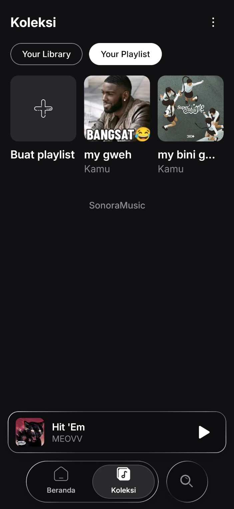
&nbsp;&nbsp;
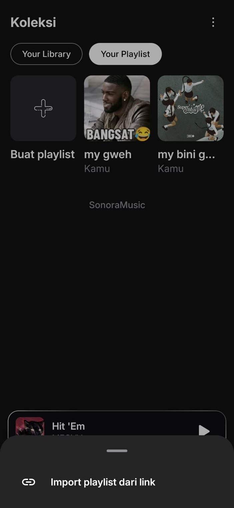
</div>

---

## 🎤 Halaman Artis

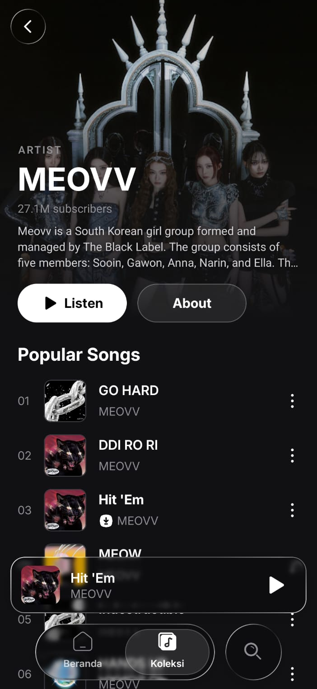

- **Hero image** layar penuh dengan nama artis dan jumlah subscriber.
- Bio ringkas yang bisa dibuka penuh lewat tombol **About**.
- Tombol **Listen** untuk langsung memutar seluruh lagu populer.
- Daftar **Popular Songs** bernomor, lengkap dengan menu aksi dan penanda unduhan.

<br clear="left">

---

## 🔍 Pencarian

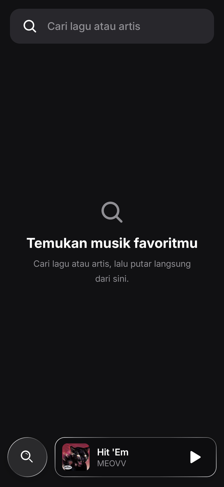

- Cari **lagu atau artis**, lalu **putar langsung** dari hasil pencarian.
- **Riwayat pencarian** tersimpan dan bisa dihapus kapan saja dari Pengaturan.
- Tombol cari berbentuk kaca di bottom bar, berdampingan dengan mini player.

<br clear="right">

---

## ⚙️ Pengaturan Lengkap

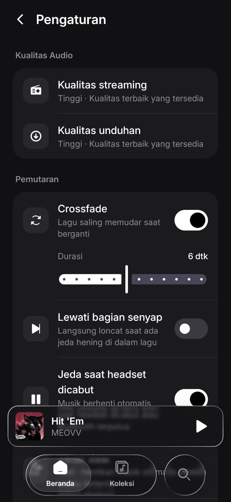

**Kualitas Audio**
- Kualitas streaming dan kualitas unduhan terpisah: **Rendah (~50 kbps)**, **Sedang (~128 kbps)**, **Tinggi (terbaik yang tersedia)**.

**Pemutaran**
- **Crossfade** – lagu saling memudar saat berganti, durasi bisa diatur lewat slider.
- **Lewati bagian senyap** – loncat otomatis saat ada jeda hening di dalam lagu.
- **Jeda saat headset dicabut** – musik berhenti otomatis saat headset/Bluetooth terputus.
- **Timer tidur** – musik berhenti otomatis setelah 15, 30, 45, 60, atau 90 menit.
- **AutoMix** – transisi ala DJ yang menyesuaikan tempo *(segera hadir)*.

**Unduhan dan Penyimpanan**
- Unduh hanya lewat **Wi-Fi**, lihat jumlah lagu terunduh, hapus semua unduhan, dan bersihkan cache.

**Riwayat & Notifikasi**
- Hapus riwayat pencarian dan riwayat putar, atur notifikasi pemutar.

**Tentang**
- Informasi aplikasi dan lisensi open source.

<br clear="left">

---

## 🧱 Teknologi

| Bagian | Teknologi |
|---|---|
| Bahasa & UI | Kotlin, Jetpack Compose, Material 3, Navigation Compose |
| Pemutar | AndroidX Media3 (ExoPlayer + MediaSession), `CrossfadeManager` kustom |
| Sumber stream | [NewPipeExtractor](https://github.com/TeamNewPipe/NewPipeExtractor) |
| Chart & rilis baru | API publik Deezer |
| Lirik | [LRCLIB](https://lrclib.net) |
| Jaringan & gambar | OkHttp, Coil |
| Efek kaca | [Haze](https://github.com/chrisbanes/haze), [Backdrop](https://github.com/Kyant0/AndroidLiquidGlass) |
| Ikon & font | Phosphor Icons, Material Icons Extended, Inter |

**Arsitektur singkat**

```
app/src/main/java/com/fahrii/musicapp/
├── data/            # Repository: musik, chart, lirik, unduhan, riwayat, replay, playlist, pengaturan
├── ui/              # Layar Compose + ViewModel (Home, NowPlaying, Library, Replay, Settings, ...)
├── PlaybackService  # MediaSessionService untuk pemutaran latar belakang
├── CrossfadeManager # Logika crossfade antar lagu
└── MainActivity
```

---

## 🚀 Menjalankan Proyek

**Prasyarat**
- Android Studio versi terbaru
- JDK 17
- Perangkat/emulator dengan **Android 8.0 (API 26)** ke atas

**Langkah**

```bash
git clone https://github.com/Fahri-Husain/SonoraMusic.git
cd SonoraMusic
./gradlew assembleDebug
```

Atau buka folder proyek di Android Studio, tunggu *Gradle sync*, lalu tekan **Run ▶**.

APK debug ada di `app/build/outputs/apk/debug/`.

---

## ⚠️ Catatan

SonoraMusic dibuat untuk **tujuan belajar dan penggunaan pribadi**. Konten audio, sampul, dan lirik adalah milik pemegang hak ciptanya masing-masing. Harap gunakan sesuai ketentuan layanan sumber yang digunakan.

---

<div align="center">

Dibuat dengan ❤️ oleh [Fahri Husain](https://github.com/Fahri-Husain)

</div>
